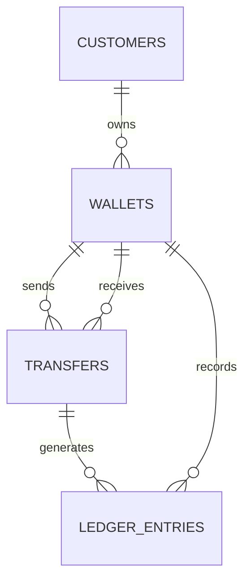

# Portfolio 1 — Database design and modelling

## Simulated Naira Wallet Platform

Customers can send naira to other wallets and check their transfer history. Operations staff track transfer requests, while reconciliation staff match completed transfers with their debit and credit records. The database keeps information on customers, wallets, transfer requests, and ledger entries. All examples used here are synthetic. This exercise does not cover funding, withdrawals, card payments, or transfers to external banks.

## Entity relationships

Every wallet has one owner. Every transfer has one source and one destination. A pending or failed transfer has no ledger entries. A completed transfer has exactly one debit against its source wallet and one credit against its destination wallet.

## Relational schema

| Table | Primary key | Other columns and keys |
|---|---|---|
| customers | customer_id | display_name, created_at |
| wallets | wallet_id | customer_id (FK → customers), balance_kobo, created_at |
| transfers | transfer_id | source_wallet_id and destination_wallet_id (FKs → wallets), request_reference (unique), amount_kobo, status, created_at |
| ledger_entries | transfer_id + direction | transfer_id (FK → transfers), direction, wallet_id (FK → wallets), posted_at |

All fields are required. The platform supports NGN only, so amounts are stored as whole kobo using PostgreSQL bigint. Each ledger entry uses its transfer's amount, which is stored once on the transfer. The transfer amount and wallet references are fixed after posting.

## Integrity rules

- Check constraints require a positive transfer amount, a non-negative wallet balance and distinct source and destination wallets.
- Check constraints restrict transfer status to pending, completed or failed, and direction to debit or credit.
- The unique request reference identifies retries. The composite ledger key permits at most one entry of each direction per transfer.
- The transaction exercise will enforce the rules that span rows and tables. The posting operation will pair the debit with the source wallet and the credit with the destination wallet, update both balances and mark the transfer completed atomically.

## Normalisation

Each field holds one value, and ledger entries are separate rows, satisfying 1NF. In ledger_entries, posting details describe the combination of a transfer and a direction, satisfying 2NF. Customer details are stored on customers, and transfer amounts stay on transfers, so they are fetched by joining on their keys. The stored wallet balance is a deliberate derived value for fast balance checks. Its updates must occur in the same transaction as the corresponding movements.

## Verification plan

| Test | Expected result |
|---|---|
| Insert a pending transfer for ₦3,000 between two existing wallets | Accepted |
| Insert a transfer to its own source wallet | Rejected by the distinct-wallet check |
| Reuse an existing request reference | Rejected by the unique constraint |
| Insert a transfer with an unknown wallet ID | Rejected by the foreign key |
| Complete a ₦3,000 transfer with starting balances of ₦10,000 and ₦2,000 | Final balances of ₦7,000 and ₦5,000, with two ledger entries |

In a fresh PostgreSQL training database, run `01-schema.sql` once, then `02-constraint-checks.sql` in the same database. With psql, use `psql -X -v ON_ERROR_STOP=1 -f <file>`. See [the PostgreSQL output](postgresql-output.txt) for the measured constraint checks. The final scenario in the table belongs to Portfolio 3.

