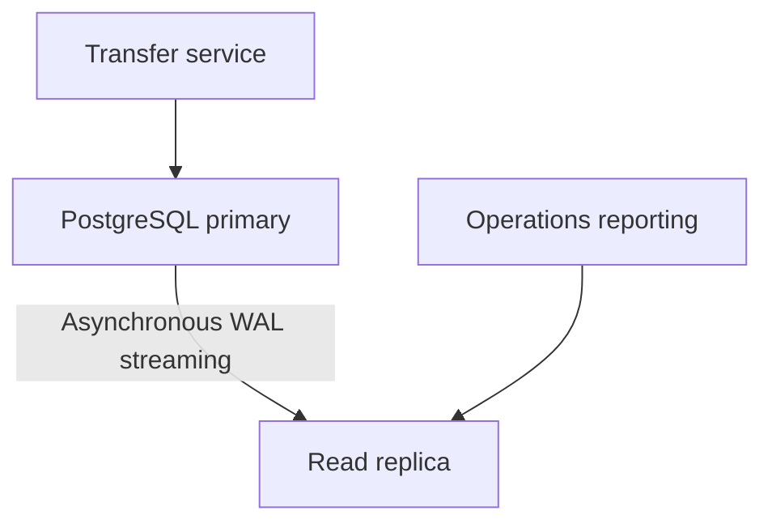

# Portfolio 5 — Distributed and cloud database design

## Proposed topology

The proposed cloud design places the primary and standby in distinct availability zones. The transfer service writes only to the primary and reads it for current spendable balances, transfer decisions and immediate post-transfer confirmation. Operations reports can read the asynchronous replica if their freshness threshold permits it. A freshness breach sends the report to the primary or marks the replica view stale. Budget for the extra database capacity and WAL traffic across zones.

## Failure and recovery

If replication traffic is interrupted, the standby may still serve older data. Monitor replay state and WAL backlog. PostgreSQL's primary can use `pg_stat_replication` and compare `pg_current_wal_lsn()` with a replica's `replay_lsn` using `pg_wal_lsn_diff`. The byte gap indicates WAL backlog. A heartbeat transaction can measure how long it takes a new write to become visible on the replica.

Before promoting a standby, fence the old primary to avoid conflicting writes. An asynchronous standby may lose a recently acknowledged transfer if its WAL has not reached the standby at promotion time. After failover, reconnect the application and investigate ambiguous transfer requests by unique reference against the promoted database and corroborating records before retrying. A unique reference can prevent duplicate posting only where the original commit survived. Synchronising a standby before COMMIT acknowledgment can reduce loss risk, with increased latency and possible write delays during replica outages.

## Sharding decision and verification plan

This exercise keeps wallets on one write primary so both sides of an internal transfer share one ACID transaction. Sharding by wallet would turn some transfers into cross-shard operations, adding coordination and failure recovery. Evaluate sharding after measuring a sustained primary bottleneck.

A deployment test would post a synthetic transfer, measure replica visibility, pause replication to observe a stale report, then perform a controlled failover and reconcile balances and ledger counts. This exercise documents the proposed design and test plan. No cloud or replica was deployed.
